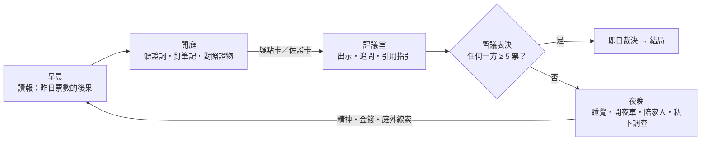

# Core Loop 推論與提案

> **結論先講：** 驅動元素是 **「懷疑」**。
> 它在法庭被「賺」到，在評議室被「花」掉，在夜裡被追討「代價」。
> 再加一條虛構法例 **「五票即決」**：陪審團每天休庭後都要表決，任何一方夠五票，審判即時結束。懷疑就由一個主題，變成每天都要守住的資源。

---

## 0. 我們要找的是甚麼

這裡說的「驅動元素」，要同時做到四件事：

1. **每一輪都會回來**：不是只在結局出現一次的壓力。
2. **逼人取捨**：資源不夠，不能甚麼都做。
3. **有因果**：今天的結果會改變明天的處境。
4. **本身就在說主題**：玩法就是故事，不用靠過場動畫解釋。

## 1. 拆解 Papers, Please

| 層次 | Papers, Please 的做法 | 它的作用 |
|---|---|---|
| 輸入流 | 入境者一個接一個來 | 每分鐘都有新決定 |
| 規則 | 每天更新的規則書 | 複雜度遞增；「制度」有實感 |
| 工具 | 檢查模式：點兩份文件，找出矛盾 | 「被我發現了」的手感 |
| 決定 | 蓋章：批准／拒絕 | 清晰、不可撤回 |
| 稀缺 | 時鐘、桌面空間 | 趕時間就會出錯 |
| 回饋 | 處理一人收一份錢；出錯被警告、扣錢 | 效率等於收入 |
| 壓力 | 夜晚帳單：租、食物、暖氣、藥 | 把「做好份工」綁死在「養活家人」上 |
| 道德 | 入境者各自的故事、賄賂、地下組織 | 規則與人性互相衝突 |

**關鍵洞察：** Papers, Please 的引擎不是「檢查文件」，而是 **「家人靠你的效率活下去」**。檢查只是動詞，帳單才是引擎。它令「守規矩、做得快」和「做個好人」互相衝突，玩家被系統一步步推成共犯。

所以我們要找的不是「法庭版的檢查文件」，而是 **「法庭版的那張帳單」**。

## 2. 為甚麼不能直接搬

| 問題 | 說明 | 推導出的要求 |
|---|---|---|
| ① 一場審判只有一個裁決 | Papers, Please 一天蓋幾十次章，審判只在最後蓋一次。中途沒有決定，前面就只是看戲 | **每天都要有「可能就此結束」的決定** |
| ② 陪審員是被動的 | 不能盤問、不能調查、不能反對，只能聽、記、討論、投票 | **主要動詞是「注意、對照、說服」**，不是調查 |
| ③ 沒有標準答案 | 護照過期就是過期，但審判的「真相」玩家永遠核對不到 | **把可核對的（程序、矛盾）和不可核對的（真相）分開**：前者即時回饋，後者留給結局 |
| ④ 沒有人逼你 | 陪審員不靠裁決賺錢，沒有理由趕 | **要有一股力，把玩家推向「隨大隊、早點回家」** |

## 3. 六個候選驅動元素

### A. 生計：直接搬 Papers, Please 的帳單
- **循環：** 陪審期間少賺錢 → 夜晚分配不夠用的錢 → 家人狀況變差。
- **好處：** 已被證明有效；共犯感最強（要求 ④）。
- **問題：** 錢和審判內容無關。它只是外來的壓力，不會令「聽證詞、做判斷」本身變得有趣。
- **結論：** 留作夜晚的代價層，不當引擎。

### B. 注意力：筆記格有限，證詞不等人
- **循環：** 證詞自動推進 → 只能把少數句子釘進筆記 → 只有筆記裡的東西能在評議室使用。
- **好處：** 最貼近「只能從主角出發、用自己手上的證據」；有 Papers, Please 式的手忙腳亂（要求 ②③）。
- **問題：** 這是手感，不是引擎。單獨存在只會變成記憶測驗，沒有長線賭注。
- **結論：** 成為開庭階段的核心操作。

### C. 七票：評議室裡的影響力
- **循環：** 每位陪審員有立場、偏見、弱點 → 用論點爭取他們 → 最後計票。
- **好處：** 這就是《十二怒漢》，陪審員幻想的核心。
- **問題：** 若只在最後投票，評議室就是一個「最後解一次」的謎題，前面幾天沒有賭注（要求 ① 只做到一半）。
- **結論：** 成為評議室系統。

### D. 規則與真相：法官指引就是規則書
- **循環：** 法官每天加新指引（不可考慮某份證供、不可自行調查）→ 但真相往往就在被禁止的地方 → 犯規可以接近真相，但可能令審訊無效。
- **好處：** 最有 Papers, Please 的道德 DNA（要求 ③）。
- **問題：** 它製造兩難，但不會自己轉動，沒有每天的節奏。
- **結論：** 成為道德層：規則書、「不予採納」、私下調查。

### E. 七種視角：羅生門式多周目
- **循環：** 同一場審判，換另一位陪審員再玩一次；每人看到的、在乎的、承受的都不同。
- **好處：** 直接回應「一開始只能從主角出發」，也是多結局擴展的天然骨架。
- **問題：** 這是周目結構，不是一局之內的循環；內容成本最高。
- **結論：** 成為路線結構（見 [02 §6](02-game-design.md#6-七席與視角)）。

### F. 懷疑 × 五票即決（推薦）
- **循環：** 在法庭找到矛盾 → 得到「疑點」→ 在評議室用疑點移動票數 → 每天表決，**夠五票就即時結案** → 撐住的代價在夜裡清算。
- **好處：** 唯一一個令 **每一天都可能是最後一天** 的方案，而且用同一種貨幣把三個階段串起來。
- **問題：** 評議室的說服系統要夠「系統化」，否則會變成對號入座（見 §8）。

### 比較

| 候選 | ① 每天有生死 | ② 陪審員的動詞 | ③ 程序／真相分層 | ④ 推人隨大隊 | 最大風險 | 成本 |
|---|:-:|:-:|:-:|:-:|---|:-:|
| A 生計 | ○ | ○ | ○ | ● | 與審判內容脫節 | 低 |
| B 注意力 | ○ | ● | ● | ○ | 變成記憶測驗 | 低 |
| C 七票 | ◐ | ● | ◐ | ◐ | 只在最後解一次 | 中 |
| D 規則與真相 | ○ | ◐ | ● | ◐ | 不會自己轉動 | 中 |
| E 七種視角 | ○ | ◐ | ◐ | ○ | 內容量爆炸 | 高 |
| **F 懷疑 × 五票即決** | **●** | **●** | **●** | **●** | 評議室變對號入座 | 中 |

● 強　◐ 部分　○ 弱

**A 到 E 沒有被淘汰，而是被收編：** F 是脊椎；B 是開庭的手感，C 是評議室，A 是夜晚的代價，D 是道德層，E 是多周目結構。

## 4. 推薦方案：懷疑 × 五票即決

### 4.1 一條虛構法例

《司法效率條例》，為消化積壓案件而設，今年是實施第二年：

1. 每個庭審日休庭後，陪審團必須進行 **「暫議表決」**：有罪／無罪／未決。
2. 任何一方達到 **五票**，即日裁決，審判終止。**還沒出庭的證人，永遠不會出庭。**
3. 每日票數向公眾公佈，「以示透明」。

> 七人陪審團、最少五人同意才成裁決，是香港現行制度的規模；人數減至六人仍需五票，減至五人則須一致（見[社區法網 CLIC](https://clic.org.hk/zh/topics/policeAndCrime/court_procedure/jury/majority_verdicts)）。「每天表決、即日結案、公開票數」是虛構的部分，也是這個世界的反烏托邦設定。

### 4.2 懷疑是貨幣

| | 怎樣運作 |
|---|---|
| **賺** | 在法庭把證詞和證物對照。兩者合起來 **動搖** 控方證據鏈的某一環（矛盾，或另一個合理解釋）→ **疑點卡**；合起來 **鞏固** 某一環 → **佐證卡** |
| **花** | 在評議室針對某位陪審員、某一環出示卡片，移動他的立場 |
| **借** | 追問其他陪審員：他注意到而你錯過的東西，會變成你「借來的證據」 |
| **失效** | 法官指引可以令某些卡被蓋上紅色「不予採納」；繼續用就是犯規 |

### 4.3 五票即決是時鐘

- **第一天，控方先講。** 評議時已經有四個人傾向有罪。你投有罪 → 五票 → 審判在第一天結束。玩家的第一個重大決定，開場十多分鐘就出現。
- **之後每一天**，新證供都會把房間推向某一邊。你要判斷：**撐住**（讓審判延續，聽更多證人），還是 **收網**（你已經確信）。
- **不只要防有罪那一邊。** 如果大家因為薄弱的理由太早傾向無罪，你可能也要「拉住」他們，因為下一個證人可能會改變一切。
- 評議室因此不是結局前才出現的一場辯論，而是 **每天都要守住的天秤**。

### 4.4 懷疑有代價

撐住一天，就要多付一天：

| 代價 | 落在哪裡 |
|---|---|
| 生計 | 主角是夜更的士司機：白天要上庭，晚上開車就沒得睡，不開車就交不到租 |
| 房間的耐性 | 「你係咪想拖到聖誕呀？」一直反對卻拿不出新論點，你的信用會下跌 |
| 外界壓力 | 票數越接近，記者、示威、恐嚇、收買就越多 |
| 家人 | 陪女兒、照顧母親的時間被擠走 |

這就是 Papers, Please 的共犯感：**最容易走的路，永遠是跟大隊、早點回家。**

### 4.5 一句話

> **真相需要時間，時間需要懷疑。**
> 審判能延續多久，取決於還有多少人在懷疑；而每一份懷疑，都要有人付錢。

## 5. 一天的循環

| 階段 | 時長 | 玩家做甚麼 | 產出 |
|---|---|---|---|
| **早晨**：讀報 | 約 30 秒 | 看昨日票數造成的後果；可以偷看案件報道（輕微犯規） | 世界的反應、提示 |
| **開庭**：聽證 | 約 6 分鐘 | 證詞自動推進；把句子釘進筆記（格數有限）；放大證物；把兩項對照 | 疑點卡、佐證卡 |
| **評議**：暫議 | 約 5 分鐘 | 聽各人立場；出示、追問、引用法官指引、附和；最後投票 | 立場變化、借來的證據、票數 |
| **夜晚**：生活 | 約 2 分鐘 | 兩個時段：睡覺／開夜車／陪家人／整理筆記／私下調查；處理突發事件 | 精神、金錢、家人狀態、庭外線索、風險 |

### 每天都多一點東西（Papers, Please 式遞增）

| 日 | 新規則（法官指引） | 新工具 | 新壓力 |
|---|---|---|---|
| 1 | 只可依據呈堂證據；不可自行調查、不可閱讀報道 | 筆記、放大、對照 | 第一次暫議 |
| 2 | 傳聞證據不可作為事實依據 | 提問紙條（每日一張） | 記者接觸 |
| 3 | 某份證供被裁定不可接納，必須完全不予考慮 | 要求重讀庭審記錄 | 交租日 |
| 4 | 專家意見只供參考 | 證物並排比較 | 收買／恐嚇 |
| 5 | 法官總結；可考慮替代罪名 | 最終表決（不設未決） | 一切結算 |

## 6. 一張卡的旅程

取自[範例案件](03-sample-case.md)，示範三個系統怎樣自然地撞在一起：

1. **第一天・開庭。** 控方呈上被告簽署的口供。放大之後，頁底有一行歪斜的手寫字：「我只係喺地下點過張紙」。同一天，督察說起火點在三樓樓梯。對照 → **疑點卡：口供的點火位置與起火點不符。**
2. **第一天・評議。** 你把卡出示給最在乎口供的主席，他由「有罪」變成「未決」。票數變成有罪 3、無罪 1、未決 3，審判活過了第一天。
3. **第三天・開庭。** 法官裁定口供在不當情況下取得，不可接納：「陪審團必須完全不考慮口供。」你的卡被蓋上紅色 **「不予採納」**。
4. **問題來了：** 這張卡指向真相，但它已經不合法。
   - **守規矩**：放棄它。
   - **照用**：仍然有效，但任何人都可以引用指引反擊你；被主席上報的話，你會被解除職務（這是一個結局）。
   - **找合法的路**：追問退休消防隊長，他指出第一天那張樓梯相片的角落、地下寫字樓門口有一道燒痕 → 第四天用提問紙條問消防調查主任 → 主任承認可能另有起火點 → 你得到一張 **乾淨的** 疑點卡。

這就是 Papers, Please 那種「規則 vs 真相」的時刻，而且是系統自然產生的，不是寫死的過場。

## 7. 多結局從哪裡來

結局由四條軸組合而成：

| 軸 | 可能值 |
|---|---|
| **何時結束** | 第一至五天／延長評議／無法裁決 |
| **怎樣結束** | 有罪／無罪／替代裁決／審訊無效／你被解除職務 |
| **你知道多少** | 表層／第一層／第二層／第三層真相 |
| **你付出了甚麼** | 家人、金錢、安全；你有沒有犯規 |

**提早結束不是 Game Over，而是一個「你永遠不會知道」的結局。** 尾聲的報紙會列出那些沒機會出庭的證人。這本身就是對《司法效率條例》最直接的批判，也是重玩的理由。

## 8. 風險與對策

| 風險 | 對策 |
|---|---|
| 評議室變成「對號入座」，每人只有唯一正解 | 陪審員用參數模型（立場、在乎哪一環、吃哪一套、耐性、從眾），不寫死對白樹；同一個人可以被不同的卡說服 |
| 第一天就結束，玩家覺得被騙 | 投票前清楚說明「五票即決」；結局短而有力，直接展示錯過了甚麼 |
| 證詞不等人，愛看故事的玩家受挫 | 所有證詞都留在「庭審記錄」，錯過的只是彈藥，不是劇情；提供慢速庭審選項 |
| 資訊過載 | 介面只顯示石子（立場）和卡片；數值隱藏，靠表情和台詞讀出 |
| 內容成本 | 案件以資料表製作（台詞、證物、對照、指引）；法庭內容在七條路線之間共用 |

## 9. 最小原型

**範圍：** 只做第一、二天，純文字，不做美術。

- 開庭：自動推進的證詞、6 格筆記、4 件證物、對照
- 評議：6 個 AI 陪審員（簡單參數模型）、每場 3 次發言、暫議表決
- 夜晚：只用一個「少賺了 $」的數字代表代價

**要回答的四個問題：**

1. 第一天投票時，玩家有沒有感到「這一票好重」？（觀察猶豫時間，事後訪談）
2. 玩家說不說得出某位陪審員 **為甚麼** 改變立場？（可讀性）
3. 證詞自動推進，帶來的是緊張還是挫敗？
4. 玩家會不會自發地「拉住」房間，不讓它太早倒向任何一邊？（核心策略有沒有自然出現）

## 10. 需要你決定的事

1. **法庭節奏：** 即時推進（Papers, Please 式壓力），還是可以暫停（閱讀友善）？建議：即時，加可選的慢速。
2. **世界觀：** 虛構城市（受八十年代香港啟發）配虛構法例？還是完全架空的國度（像 Arstotzka）？
3. **對白語言：** 粵語口語，還是書面語？
4. **路線：** 第一周目固定第七席、之後解鎖其他席位？還是一開始就可以選？
5. **平台：** 手機直向優先（承接舊 repo 的 iOS 方向），還是 PC／Steam 優先？
6. **範例案件：** 沿用「福安樓縱火案」，還是另起一案？
