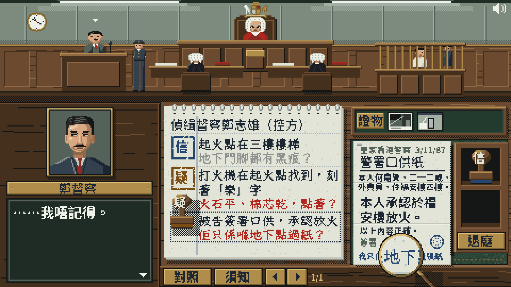
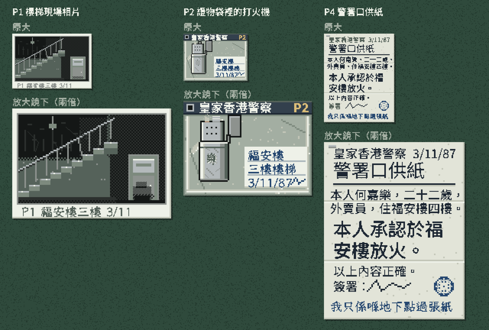

# 06 美術規範

> 目標是 *Papers, Please* 和 *Probably Stolen* 那種「桌上有實物」的質感。這份規範先定下以後很難改的東西：解像度、調色盤、字、版面、手感。手感切片（[prototype/desk/](../prototype/README.md#桌面手感切片)）就是按這份規範做的，所有美術都是程式畫的佔位圖。為甚麼要這樣做，見 [03 質感](03-feel.md)。

## 1. 這種風格由五樣東西組成

1. **固定的小畫布：** 480×270，按整數倍放大，每一點都是同樣大小的方格。
2. **有限的調色盤：** 全遊戲 32 色，每件物件只用三、四個深淺。
3. **點陣字：** 字也是像素，邊緣沒有半透明的點。
4. **桌上的實物：** 證物、筆記本、放大鏡、印章都拿得起、拖得動、疊得起來。介面就是這些東西。
5. **聲音和重量：** 每個動作都有聲音；蓋章時畫面會震一下。

## 2. 畫布和放大

| 項目 | 規定 |
|---|---|
| 解像度 | 橫向 480×270。全螢幕時 1080p 剛好 ×4，4K 剛好 ×8 |
| 放大 | 按螢幕實際像素取最大的整數倍，四邊留黑。唯一例外：觸控螢幕上，每個遊戲像素已經有三個或以上實際像素，而整數倍會浪費超過 15% 位置時，放大到剛好填滿 |
| 手機 | 橫放。844×390 的手機剛好 ×4；網址列佔去高度時是 ×3.6。直放時畫面只有 ×2，所以提示玩家把手機橫放 |
| 直向版面 | 未做。桌面需要闊度，直向要另外設計，見 [05 §5](05-production.md#5-未決定的事) |

## 3. 調色盤（32 色）

| 組別 | 顏色 | 用途 |
|---|---|---|
| 墨和紙 | `#1d2733` 墨、`#141716` 黑、`#eef1e8` 白、`#e2e4d8` 紙、`#c3c6b8` 紙影、`#aab6bb` 紙線 | 文件、筆記本、對白字 |
| 法庭牆身 | `#55625a`、`#7d8a7e`、`#a3aea2`、`#1f2b25` 底板 | 日光燈下的青綠；對白框和彈出視窗的底色 |
| 柚木 | `#45301e`、`#6b4a2f`、`#8f6845` | 法官席、牆板、陪審桌 |
| 皮革 | `#233a2e`、`#2f4a3c` | 桌面上放證物的綠色皮革 |
| 銅 | `#7a5f30`、`#b08d4a`、`#dbbd78` | 名牌、按鈕、放大鏡、提示字 |
| 印泥和紅筆 | `#24466f` 信、`#7a4d14` 疑、`#b3261e` 紅 | 只用在印章和批註 |
| 人物 | `#eec7a1`、`#d8a982`、`#ad7c5a` 皮膚、`#2a2626` 頭髮、`#1b1d22` 法袍、`#8a2a24` 法官紅袍、`#33404d` 西裝、`#8a7a52` 卡其 | 人物和衣服 |
| 物件 | `#8d928e` 灰、`#b3b9bb` 金屬、`#2c302e` 相片 | 證物 |

**紅色只表示兩件事：** 你親手找出的矛盾（對照的紅線、紅筆批註），以及「不予採納」。筆記本的頁邊線和證物袋都不用紅色。紅色少用，出現時才有份量。

## 4. 字

| 用途 | 字型 | 大小 | 份量 |
|---|---|---|---|
| 對白 | Noto Sans TC，字重 500 | 13px，行距 16 | 每行 9 字，最多 4 行：一句不超過 36 字 |
| 字幕、須知、完結頁 | Noto Sans TC，字重 500 | 12px，行距 14–15 | 字幕最多兩行 |
| 按鈕 | Noto Sans TC，字重 700 | 12px | 只用筆畫少的字（對照、須知、退庭） |
| 名牌、筆記本抬頭 | Noto Sans TC，字重 400 | 12px | 人名多是筆畫多的字（「鄭」「督」）：字重 500 以上會糊成一團，400 配門檻 120 最清楚 |
| 筆記本 | 霞鶩文楷 TC，粗體 | 12px，行距 14 | 每行 11 字；頁邊批註（`jot`）必須一行寫完 |
| 細字 | Noto Sans TC 或霞鶩文楷 | 8px | 故意看不清。放大鏡下的兩倍圖要用 16px 重新排，不可以把 8px 放大 |

- **點陣化：** 現在用網頁字型即場畫，再把每一點壓成全有或全無（透明度 110 以上算有；8px 用 90）。正式版換成點陣字（候選 Fusion Pixel Font、Cubic 11，授權要逐一核對），字的大小和份量不變。
- **斷行：** 逗號、句號、引號的後半不放行首。

## 5. 版面（橫向）

| 區域 | 位置和大小 | 內容 |
|---|---|---|
| 法庭 | (0, 0) 480×96 | 法官席、證人台、控辯雙方、犯人欄、庭警。說話的人頭上有一個上下跳的小三角 |
| 字幕 | 法庭下緣，(152, 56) 326×38 以內 | 證物送到、發現細節、批註全文、提示 |
| 特寫 | (43, 101) 64×66 框，內圖 56×60 | 正在說話的人；說話時嘴巴開合，偶爾眨眼；旁白時是法院徽章 |
| 名牌、對白 | (6, 170) 138×14；(6, 186) 138×80 | 逐字出現；最後一字出完，右下角閃一個三角 |
| 筆記本 | (154, 100) 172×148 | 每個證人一頁。頁邊線左邊蓋印，右邊寫字 |
| 證物托盤 | (330, 100) 146×28 | 庭警遞上的證物先放這裡，縮成 24×18 的小圖 |
| 桌面 | (330, 132) 146×116 皮革面 | 證物攤開來看，可以疊，也可以拖到筆記本上面 |
| 工具槽 | (150, 250) 330×20 | 「對照」、「須知」、翻頁、頁碼。按鈕的感應範圍是整條槽的高度 |
| 印章盤 | 收在右邊，滑出到 (426, 134) 52×104 | 「信」「疑」兩個印章，和「退庭」 |

## 6. 人物和證物

- **法庭小人：** 24×22，站在原位；證人走上、走下證人台時，每走四格跳一下。
- **特寫：** 56×60。切片每人三格：閉嘴、開口、眨眼。正式版每人三種表情，各有閉嘴、開口，加眨眼。
- **證物畫兩次：** 原大一次，放大鏡用的兩倍一次。兩倍圖不是把原圖放大：字按兩倍大小重新排過；有些細節（門腳的黑痕、乾掉的棉芯、頁底的手寫字）只畫在兩倍圖上，原大時最多是一條墨跡。
- **證物的細緻程度：** 每件證物都要有四樣東西：印好的表格或標籤；手寫或打字的內容；材質的質感（紙紋和摺痕、金屬的反光和刮花、膠袋的皺摺）；編號和日期。原大時細字只是一片紋理，放大後讀得出，所以玩家會想拿起放大鏡逐處看。
- **細節不可以互相遮擋：** 要用放大鏡找的細節，不可以被證物上別的東西蓋住（例如打火機不可以壓住標籤）。
- **細節的位置：** 每件證物的每個細節都要標出位置（原大的座標），對照模式和放大鏡都靠它。`test/content.test.js` 會檢查每個細節都有位置，而且在證物範圍之內。
- **印：** 22×22，每一下的缺墨都不同。印章和印都不旋轉。改印章時，舊的印劃一筆，新的蓋在上面。

## 7. 手感

| 動作 | 怎樣做 | 回饋 |
|---|---|---|
| 聽證詞 | 點左下的對白框或法庭，或按空白鍵 | 逐字出現，嗶聲的音高因人而異；旁白和你心裡的話沒有嗶聲 |
| 拿證物 | 從托盤拖出來就攤開，拖回托盤就縮回小圖；只點一下小圖，也會替你攤開 | 翻紙聲；拿起時放到最上面，陰影離遠兩格 |
| 放大鏡 | 拖動放大鏡，鏡片裡是兩倍圖；在細節上停 0.35 秒就算看到 | 兩聲輕響；放大鏡旁冒出感嘆號；字幕寫出細節。當舖朝奉看得懂的東西，接著出現他的心聲 |
| 對照 | 按「對照」，桌面用網點壓暗，只留下可以點的東西；點一個說法，再點一個細節或另一個說法 | 一條紅線逐點拉出來。配得上：紅筆在那個說法下面寫一行批註，字幕顯示全文；看得出但看不懂：鉛筆字；配不上：紅線收回，甚麼都不寫 |
| 蓋章 | 證人退庭前印章盤滑出，把印章拖到說法上 | 一下悶響、畫面震 90 毫秒；印章彈回原位。拖到空白處，印章自己彈回去 |
| 須知 | 按「須知」 | 《陪審員須知》蓋在畫面上，按一下合上 |

## 8. 不准做的事

- 不旋轉、不縮放像素圖。印章蓋下去也是正的。
- 不用平滑的透明度、漸變、發光。壓暗用網點；淡出分三格做完。
- 不用平滑的字。
- 除了第 2 節的例外，不用非整數放大。
- 畫面上不出現數值、分數、剔號或交叉。
- 系統開了「減少動態」時，蓋章不震。

## 9. 流程

| 步驟 | 內容 | 狀態 |
|---|---|---|
| 1 參考板 | *Papers, Please*、*Probably Stolen*、八十年代香港法庭和當舖的照片 | 未做 |
| 2 手感切片 | 第一天的法庭桌面，佔位美術，試四種手感 | 完成：`prototype/desk/` |
| 3 美術規範 | 本文件 | 完成，按試玩修改 |
| 4 風格定稿圖 | 一張完整上色的 480×270 法庭桌面，只做這一張 | 第一版完成，見下面第 10 節；等你看過再改 |
| 5 量產 | 按 `desk/art.js` 裡的材質名字和尺寸逐張替換佔位圖；版面和互動不用改 | — |

## 10. 風格定稿圖（第一版）

畫的一刻：鄭督察答辯方「……我唔記得。」；放大鏡停在口供頁底的手寫字上，「地下」兩個字放大了；筆記本上已經寫了紅筆批註，你正拿起「疑」字印章。原大的圖是 `art/style-frame/court-desk.png`（480×270），四倍的是 `court-desk@4x.png`。圖由 `art/style-frame/frame.js` 逐點畫出：用本地伺服器打開 `art/style-frame/index.html` 就看得到，在圖上按右鍵可以另存原大的 PNG。

這一版定下來的做法：

- **人像：** 逐行定好皮膚的範圍，光從左上方來，分四級皮膚色；五官逐點放。背景用牆色，黑頭髮和深色西裝才分得開。為了皮膚的亮位，調色盤用 `#eec7a1` 取代了和金屬色太接近的證物袋灰，仍然是 32 色。
- **法庭：** 法官是焦點：頭上有皇家徽章，背後是雕花高背椅，紅袍配白色領帶。大律師背向我們坐，椅背在我們這邊。
- **證物袋：** 不透明的淺灰綠，加反光和摺痕。用網點做透明試過，會變成一格格的紗窗。
- **陰影：** 全部向右下，用網點；拿起來的東西，影子離得遠一點。
- **字：** 名牌和筆記本抬頭用字重 400（見第 4 節）。

已經定了：色調（日光燈的青綠加柚木）、人像的寫實程度、法庭那一條的細緻程度，都照這一版。

### 證物樣板

`art/style-frame/evidence.png` 是三件證物的樣板：上面是放在桌上的原大，下面是放大鏡下的兩倍。證物由 `art/style-frame/evidence.js` 畫，尺寸和細節位置都寫在裡面的 `EVIDENCE` 表，量產時連細節位置一起搬進遊戲。

- **相片：** 黑白，煙薰的牆、燒彎的欄杆、白邊上的鉛筆字；門腳的黑痕放大才看得清。
- **證物袋：** 封口條印著「皇家香港警察」，手寫標籤寫地點和日期；打火機的蓋翻開，火石輪和乾掉的棉芯放大才看得清。打火機和標籤分開放，互不遮擋，所以細節位置和現在遊戲裡的不同。
- **口供紙：** 印好的表頭、打字的內容、摺成三份的摺痕、簽名、警署的圓印；頁底的手寫字放大才讀得出。
